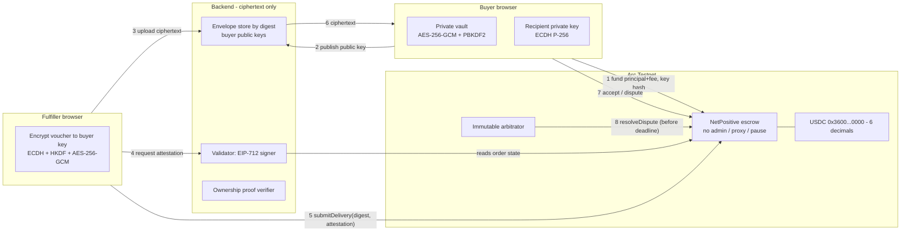

# NetPositive architecture

NetPositive is a reusable USDC voucher escrow for Arc Testnet. The buyer is the crypto seller: they lock
principal plus a 1% fee. The fulfiller delivers a client-encrypted voucher and receives the full principal.



## Data boundaries

| Data | Browser | Backend | Chain |
| --- | --- | --- | --- |
| Voucher plaintext, PAN, CVV, PIN, OTP | yes (tab only) | never | never |
| Vault passphrase, vault plaintext, private keys | yes (tab only) | never | never |
| Ciphertext envelope | yes | stored by digest | digest only |
| Buyer public key | yes | stored | keccak256 commitment |
| EIP-712 attestation | yes | signed here | verified here |
| USDC, parties, deadlines | read | read | yes |

## Order lifecycle

```
createOrder -> Open --submitDelivery (valid attestation, before deadline)--> Delivered
Open --after delivery deadline, anyone--> Refunded (principal + fee to buyer)
Delivered --buyer accepts, or review period ends uncontested--> Released
Delivered --buyer disputes within review window--> Disputed
Disputed --arbitrator rules before dispute deadline--> ResolvedForBuyer | ResolvedForFulfiller
Disputed --anyone, after dispute deadline--> SplitFallback (50/50 principal, fee back to buyer)
```

Every settlement only credits an internal balance. Each account calls `withdraw(to)` for its own credit, so a
blocked recipient cannot stop anyone else.

## Delivery attestation (EIP-712)

Domain: `NetPositive`, version `1`, chain id, verifying contract.
Type: `DeliveryAttestation(bytes32 tradeId, bytes32 deliveryDigest, bytes32 buyerRecipient, uint64 expiry)`.
`buyerRecipient` is the keccak256 hash of the buyer's recipient public key, committed at order creation. The
`deliveryDigest` commits to the trade id, recipient hash, ephemeral key, IV and ciphertext. A Foundry test pins
the contract's digest to the digest the TypeScript signer produces.

## ZK record ownership

A Schnorr proof of knowledge (Fiat-Shamir, secp256k1) shows that you know the secret behind a vault record's
public commitment. It proves secret knowledge only. It never proves that a voucher is valid, funded or unspent.

## Components

- `contracts/NetPositive.sol`: escrow, attestation check, deadlines, pull payments.
- `server/`: ciphertext store, validator signer, ownership verifier. Start with `bun run server`.
- `src/`: React frontend, browser crypto (`src/lib/crypto.ts`), vault (`src/lib/vault.ts`).
- `scripts/arbitrate.ts`: arbitrator CLI for the testnet demo key.
- `scripts/e2e-local.ts`: full flow on a throwaway local chain.
