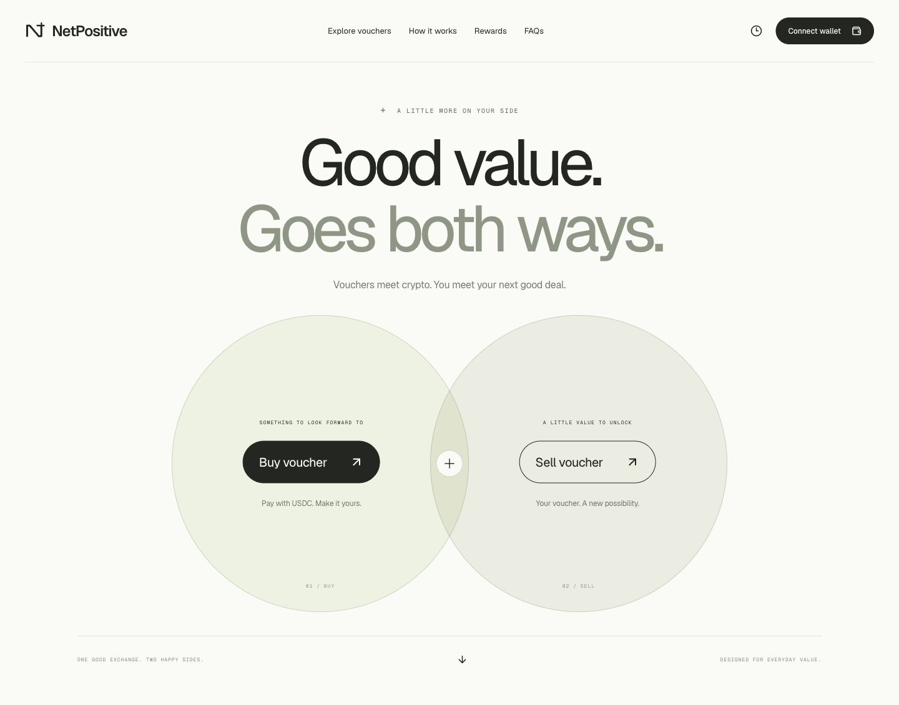

# NetPositive frontend

The first frontend lives in `apps/web`, on the `frontend` branch. Main's source-research archive is preserved.

## Run

Requires Node 22.12+ and npm 10+.

```sh
npm ci
npm run dev
```

Open the local URL printed by Vite. For production output:

```sh
npm run typecheck
npm test
npm run build
npm run preview
```

`apps/web/dist` is the static build output. No environment variables, backend, database, API credentials or deployment account are required for the preview.

## Design

Geist Variable for the interface and headlines, with Geist Mono for restrained labels. Fonts are self-hosted through Fontsource; no external font service requests. Warm paper, charcoal, muted sage, thin rules, pill actions and generous whitespace.

The user-directed hero uses two intersecting circles. Both circles are actionable, with distinct Buy voucher / Sell voucher flows, hover/focus states and a compact mobile layout. Marketplace cards, FAQ accordions and forms use the same typography and spacing.

Live references reviewed 5 November 2026:

- [Arc](https://www.arc.io/): oversized restrained type, simple navigation, geometric illustration and clear primary action.
- [Uniswap](https://app.uniswap.org/): immediate action, short labels and wallet access separated from trading.
- [Aave](https://aave.com/): concise product hierarchy and supporting explanation in lower sections.

These are design references, not copied assets, testimonials, partnerships or claims about NetPositive's scale. The mark and circle artwork are native UI/CSS/SVG, not external imagery. Brand voucher tiles are illustrative, not an assertion of inventory or merchant partnership.

## Reviewed previews



[Mobile preview](screenshots/mobile.jpg) · Browser checks at 320px, 390px, 768px and 1440px found no horizontal page overflow.

## Implemented

- Responsive homepage, primary actions and mobile menu.
- Voucher catalogue filtering/search and useful empty states.
- Buy/sell forms, amount validation, editable previews and browser-local drafts.
- Accessible native dialogs with Escape, focus containment and backdrop dismissal.
- Reward comparison fixture with direct-only mode and cap exhaustion reranking.
- FAQ, research links, privacy details and Arc/USDC links.
- EIP-6963 wallet discovery with EIP-1193 injected-provider fallback; explicit account connection, account/network change handling, copy, explorer and local disconnection.
- User-requested Arc Testnet switch/add-network flow. No automatic chain switch on page load.
- Reduced-motion support, visible keyboard focus and no analytics.

## Integration boundary

This is a frontend preview. It does not publish orders, verify voucher codes, mint vouchers, sign messages, transfer funds, call escrow contracts, prove ZK statements or authenticate an account. Wallet connection is account access only, and is independent of the local trade preview. WalletConnect/mobile QR needs a future connector and project ID; no fake QR or simulated connection is shown.

Native Arc USDC uses 18 decimals; its ERC-20 interface uses 6. This frontend does not read or combine balances, approve token allowances, or send transactions.

Network configuration was checked against [Arc's official connection guide](https://docs.arc.io/arc/references/connect-to-arc) on 5 November 2026: Arc Testnet 5042002 (`0x4cef52`), `https://rpc.testnet.arc.io`, explorer `https://explorer.testnet.arc.io`.

## Fixture economics

`src/lib/rewards.ts` is explicitly illustrative, not a production issuer feed:

- INR 5,000 Lifestyle / Infinia comparison: base 165 points, SmartBuy 825, InstaDeals INR 375 discount + 150 points = INR 525 travel value, assuming INR 1/point, unused caps and no extra fees.
- Setting voucher bonus unavailable reranks InstaDeals ahead of the base-only SmartBuy route. The 3,000 bonus-point cap remains separate from base points.
- Quote previews use an illustrative INR 90/USDC, rounded principal and fee components to two displayed decimals. Total equals the displayed components.
- The original authorised 1% fee belongs to the **crypto seller**. With voucher-facing buttons, the **voucher buyer pays crypto and is the crypto seller**, so Buy voucher includes 1%; Sell voucher does not. This mapping must be revisited if the commercial model changes.
- Quotes do not incorporate network fees or real conversion quotes. No real funds move.

Source research and unresolved eligibility limitations remain in `data/research/2026-11-05`. Rates must be freshly verified before production recommendations. The frontend does not promote PDF text into validated live rules.

## Storage and privacy

Only voucher preview drafts (brand, side, amount, timestamp) are stored under `netpositive:drafts:v1` in localStorage. They can be cleared from Drafts. Wallet address and connection state remain in memory. No card numbers, voucher codes, seed phrases or private keys are collected. Account-access requests occur only after selecting a detected wallet. External links and wallet-provider infrastructure have independent policies.

## Validation

TypeScript and production build are required. The node test suite checks rounding, bonus-cap exhaustion, cap size, invalid amounts and fee-role mapping. Browser QA covers catalogue filters, empty state, both voucher previews, local draft creation/clearing, direct-only mode, reward reranking, FAQs, wallet-unavailable state and responsive layout. A funded/installed-wallet connection and network-switch confirmation were not performed; they still require a wallet-enabled browser.

## Development attribution

This UI, styles, tests and setup were generated with Codex under the team's direction. Project-specific research and design references predate this implementation. Keep that distinction in event submissions; no history is rewritten to imply otherwise.
